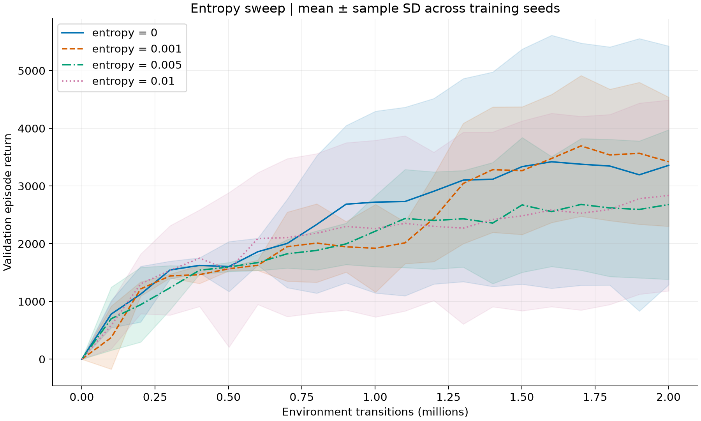
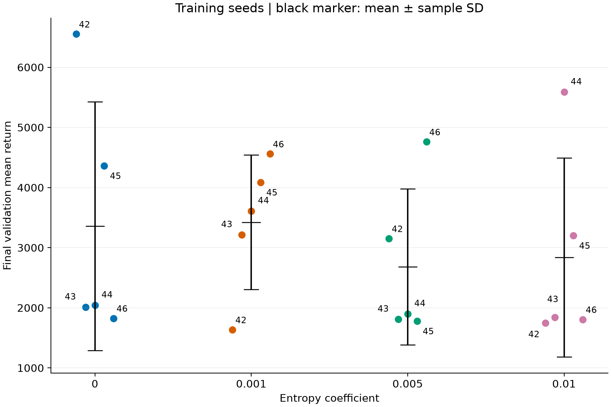

# Entropy coefficient ablation

This supplement asks whether an entropy bonus improves fixed-baseline PPO learning
in HalfCheetah-v5. It adds **15 training runs** and reuses **five compatible baseline
runs from the 2026-10-30 CUDA reproduction**. The resulting comparison contains
four groups of five training seeds. It does not replace the original 24-run study,
its selected policy, or its final test results.

## Design and provenance

- Entropy coefficients: **0, 0.001, 0.005, 0.01**.
- Fixed learning rate **0.0003**, clip **0.2**; all remaining settings follow
  `configs/entropy/entropy0.yaml`. The only configuration differences between
  comparison runs are entropy coefficient and training seed.
- Training seeds: **42–46**; requested budget 2,000,000 transitions, actual budget
  **2,000,896**, rounded up to 977 complete 2,048-transition rollouts.
- Every validation checkpoint uses deterministic actions and initial seeds
  **10000–10004**. These seeds are repeatedly used during training: they are not
  an untouched final test set. No new final testing or model replacement is claimed.
- Core training sources are byte-identical to commit
  `240f874d3781174282e8b98315714632507dc6b4`. Source hashes are preserved in each
  run's metadata. The 15 new runs were executed outside a Git checkout, so their
  recorded `git_commit` is empty. It is retained as recorded; the source hashes
  and protocol establish provenance, rather than an invented training revision.
- Actual environment: Python **3.11.15**, PyTorch **2.7.1+cu118**, Gymnasium
  **1.2.1**, MuJoCo **3.3.7**, NumPy **2.4.4**, SB3 **2.7.0**. Training used four
  available RTX 4090 GPUs, 15 concurrent single-threaded processes, synchronous
  vector environments. SB3 was installed but these runs used the custom PPO.
- New runs started **2026-10-30 19:31:56** and training/report generation finished
  **20:16:24**, Asia/Shanghai: approximately **44.5 minutes**. Parallel wall time
  must not be confused with the sum of individual training durations.

The original project's baseline validation mean is 3791.6. This supplement's
compatible reproduced baseline is **3359.4**. Do not pool these cohorts or replace
one with the other: software versions, device execution and resulting trajectories
differ. Hardware speed comparisons are not part of this supplement.

## Results

First average the five validation episodes for each trained model, then compute
the mean and sample standard deviation across the five training seeds.

| Entropy coefficient | Final validation mean ± seed SD | Change vs baseline mean | Normalized validation AUC |
| --- | ---: | ---: | ---: |
| 0 | 3359.4 ± 2067.7 | — | 2425.4 |
| 0.001 | 3422.1 ± 1118.9 | +1.9% | 2278.0 |
| 0.005 | 2680.3 ± 1296.4 | −20.2% | 1985.9 |
| 0.01 | 2837.3 ± 1654.1 | −15.5% | 2070.4 |

The SD is **between training-seed means**, not episode SD or a confidence interval.
AUC integrates the validation mean over all recorded training checkpoints and
divides by the training-step interval.




At 0.001, the final mean increases only 1.87%, while the observed seed SD decreases
45.89%. This does not establish a significant or universal improvement. Three of
five paired seeds improve, but seed 42 falls from 6552.5 to 1635.4 and seed 45 also
declines. The worst seed is lower than the baseline's worst seed, and normalized
AUC is 6.08% lower. Thus lower dispersion does not mean every run improved or that
learning became uniformly faster.

The two larger coefficients have lower group means. The
[policy-entropy curve](../results/figures/entropy/policy_entropy.png) shows that
larger coefficients preserve more policy randomness, but more randomness alone
does not imply better return. These plots are consistent with an exploration versus
policy-concentration tradeoff; they do not identify a unique cause of a poor gait.
The plotted Gaussian differential entropy is measured before action clipping and
can be negative. Zero entropy coefficient still permits stochastic action sampling.

**Conclusion:** 0.001 is a candidate for further validation, not evidence to replace
the project's selected final model. This experiment isolates entropy at clip 0.2;
it does not test its interaction with other clip values or learning rates.

## Inspect or regenerate without training

From the repository root, with the project dependencies installed:

```bash
python scripts/report_entropy.py
```

This regenerates only the entropy summary CSV/JSON, its four figures and
`tutorial/entropy.html`. It requires no model weights and leaves original study
summaries unchanged. Open [the entropy Tutorial](../tutorial/entropy.html) locally;
the data and plotting code are embedded, with no CDN or server. Controls switch
between coefficient groups, individual seeds and entropy/return, change the shown
training horizon and inspect values with mouse or keyboard.

Raw logs, metadata and configurations are in
[`results/entropy_sweep_20261030`](../results/entropy_sweep_20261030).
`raw_data_sha256.json` fingerprints the 100 imported raw files in the repository's
canonical LF format. `original_raw_data_sha256.json` retains their original local
delivery hashes. CSV CRLF line endings were converted to LF following the existing
`.gitattributes`; parsed values and metadata were not changed.
`checkpoint_hashes.json` identifies the 20 corresponding local weights.
The protocol's `reproduction_20261030/...` source labels describe local provenance,
not downloadable paths. The five reused baseline CSVs are included in this cohort.

## Run a fresh experiment

Install an appropriate PyTorch build for your machine, then the project dependencies
as described in the root README. Recorded dependency versions are above; the original
AutoDL lockfile is preserved and is not the environment lock for this supplement.
Different platforms are supported but bitwise equality is not promised.

```bash
# Inspect all 20 planned runs without writes or training.
python scripts/run_entropy_experiments.py --dry-run

# Portable default: all four coefficients, five seeds, one CPU process.
python scripts/run_entropy_experiments.py --device cpu --workers 1

# Select your own idle CUDA devices and a new output directory.
python scripts/run_entropy_experiments.py --device cuda --gpus 0,1 --workers 2 \
  --output .local/entropy_cuda

# Short integration check, not a scientific result.
python scripts/run_entropy_experiments.py --device cpu --seeds 42 --timesteps 2048 \
  --output .local/entropy_smoke
```

The driver copies the training sources into a new workspace, saves a protocol,
runs training, then generates the report there. Existing output directories are
refused. A failed run is preserved for investigation; select a new directory to
restart. This is not exact simulator/RNG checkpoint continuation.

To reuse baseline runs explicitly, add `--baseline-results /path/to/local/results`.
Each seed must have either `hc_lr0.0003_clip0.2_seedSEED` or
`hc_entropy0_seedSEED`, including **checkpoint.pt**. Configuration (including
device), completed budget, source hashes and recorded dependency versions must
match. In particular, the original repository's CPU reference CSVs are not a valid
replacement for the CUDA baseline in this study. Without this flag, all 20 models
are trained anew; a fresh clone never silently skips training because reference
metrics already exist.

## Validation and artifact policy

The original local acceptance reloaded all 20 checkpoints on CUDA and replayed
validation seed 10000, one 1000-step episode per checkpoint. Every recorded return
was reproduced with absolute difference **0**. This is a sampled replay of the
existing validation set, not a new independent test. Evidence is in
`acceptance_replay.csv` and `acceptance_recheck.json`; these are historical records
of the local binary delivery. The weights are now published through Git LFS;
run `git lfs pull` before repeating checkpoint evaluation.

Source, configurations, compact CSV/JSON, figures, this report and the standalone
Tutorial are committed. Following the explicit request to publish binaries, the
20 entropy checkpoint paths and their videos are also tracked through Git LFS.
ZIPs, raw console logs and environment directories remain excluded. The
[4090 GPU video gallery](../results/video/index.html) includes all 20 entropy
demonstrations, four five-seed comparisons and one fixed-seed coefficient comparison.
All demonstrations use environment seed 10000; video inference is CPU deterministic,
whereas the recorded training validation used CUDA. These single episodes must not
be substituted for the five-episode validation means.

Portable integration and offline-browser checks from the original metrics-only
submission are retained in `results/entropy_sweep_20261030/integration_qa.json`.
Binary-publication validation is recorded separately in
`results/video/4090_gpu/publication_qa.json`.

AI assistance was used for experiment orchestration, verification, report/plot code
and integration drafting. For the course submission, group members must review the
analysis, state their actual individual contributions and apply the course's AI-use
disclosure requirements; this repository supplement does not establish individual
authorship or compliance percentages.
