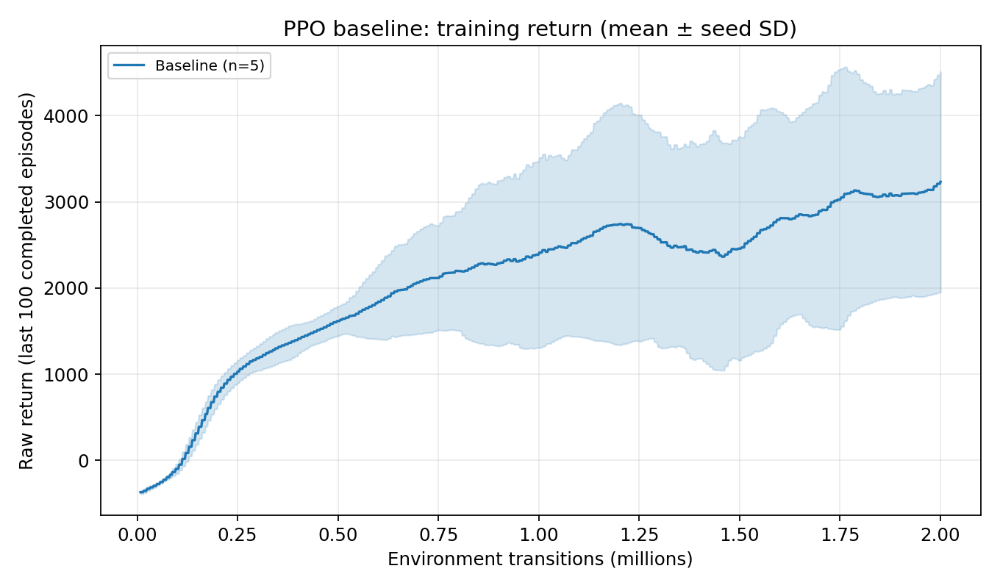
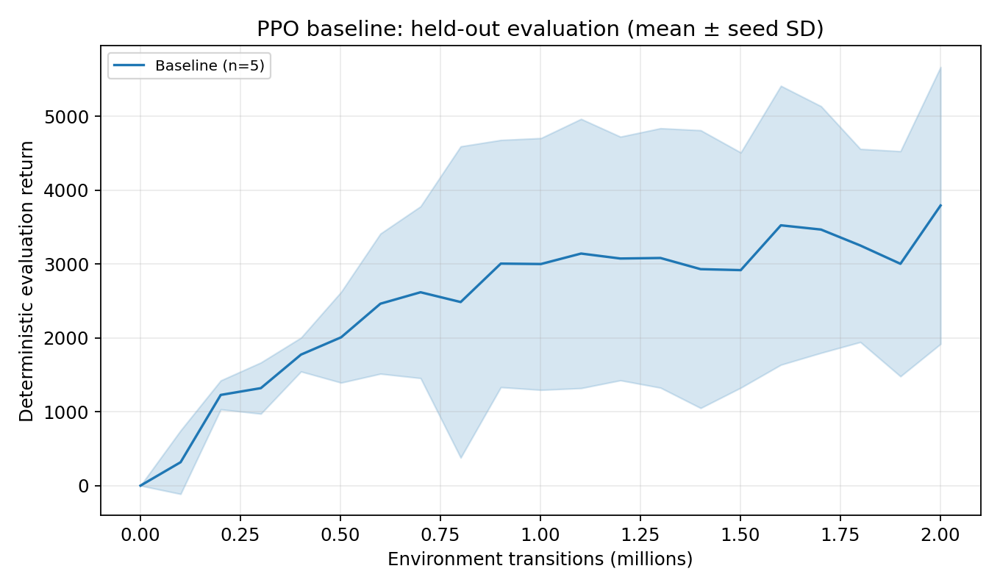
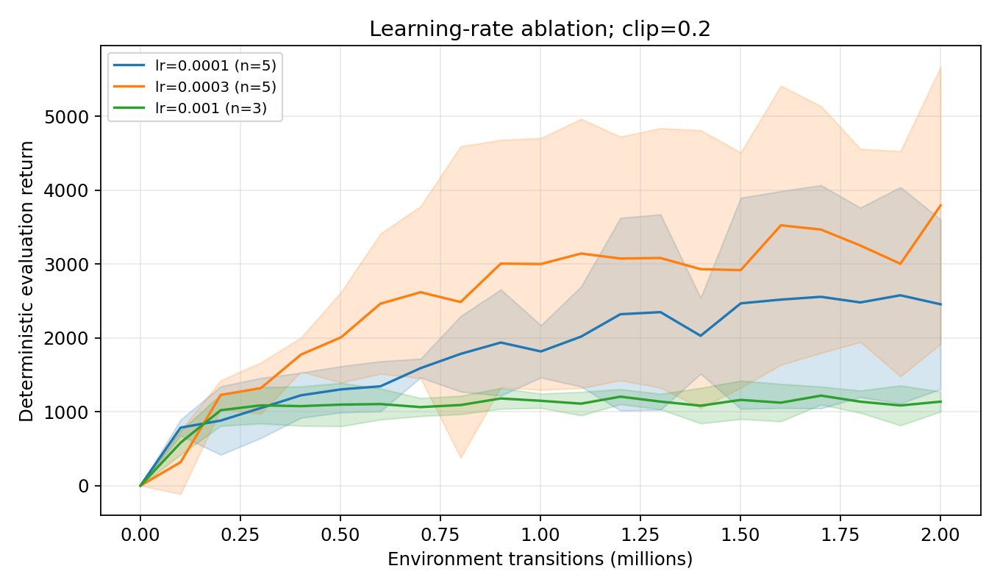
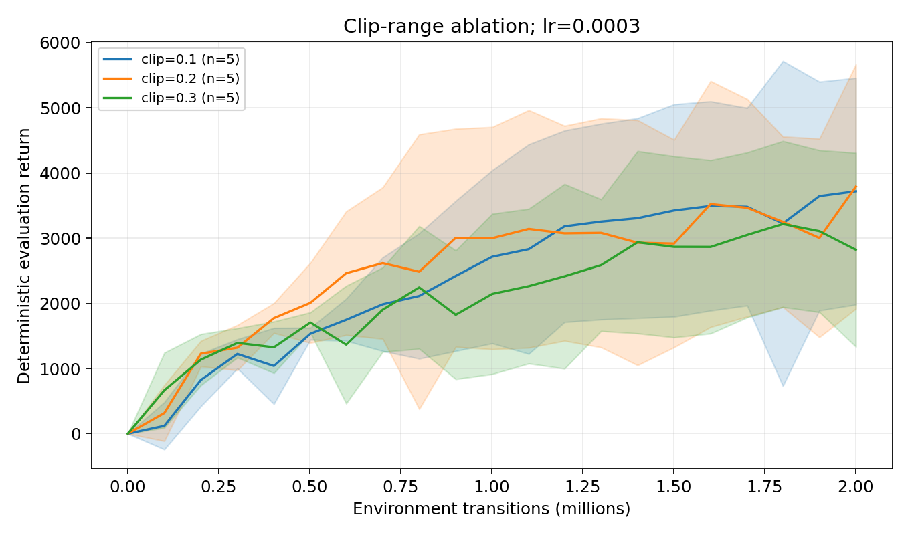
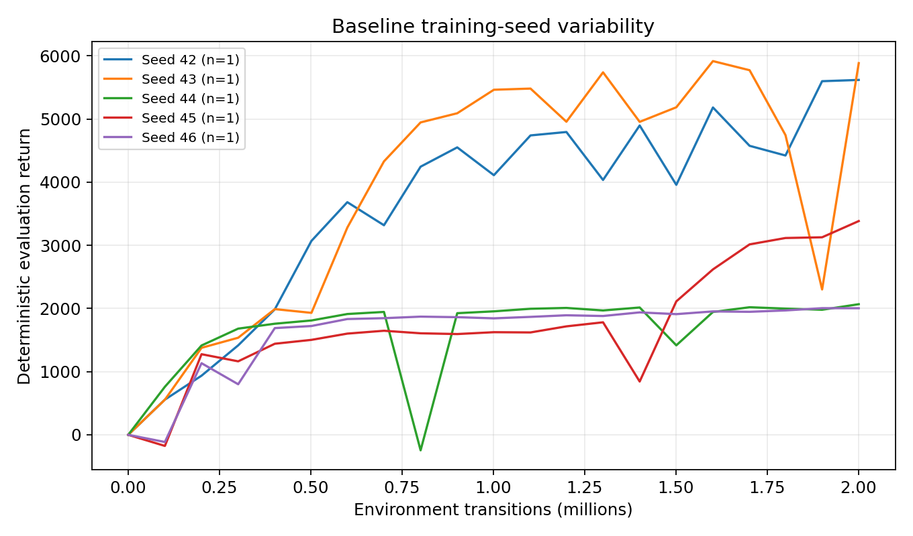
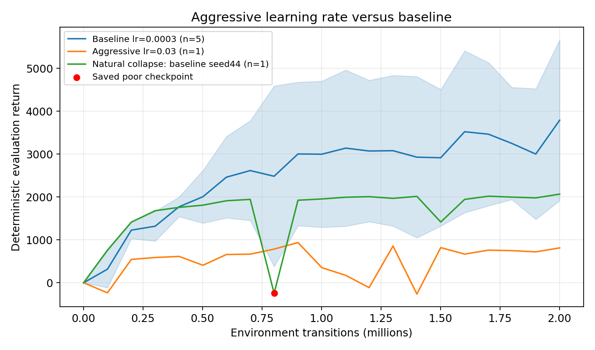
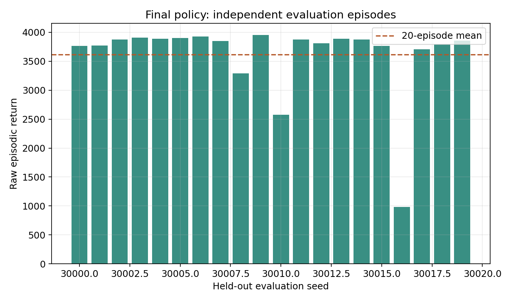
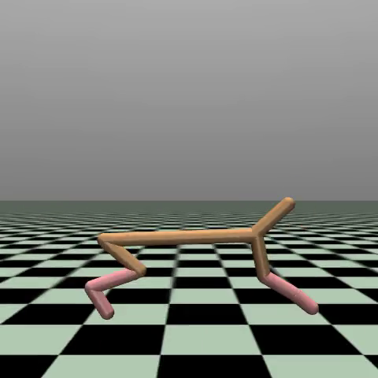

# 实验结果与课程报告材料

本文由 `scripts/write_results.py` 从真实 CSV 及 JSON 自动生成。原始数据以 `results/<experiment_id>/` 为准；所有图片均可重新绘制。

## 任务与实现

采用 Gymnasium HalfCheetah-v5：17 维观测、6 维连续动作，原始 reward 为前向速度减 0.1 倍平方控制输入。每回合最多 1000 步，默认无健康 termination。环境定义、Hopper 的 11/3 维对照和无线组网联系见 [环境材料](ENVIRONMENT.md)。

自研 PPO 包含独立 actor/critic、对角高斯策略、rollout、正确区分 termination/truncation 的 GAE 与 bootstrap、优势标准化、clipped surrogate、value loss、多轮 minibatch Adam、梯度裁剪、normalization、checkpoint 和独立评估。数学及代码解释见 [算法笔记](ALGORITHM.md)。SB3 仅作参考 benchmark。

## 实验规模与协议

完成 **24 个正式实验**：初始 15 个正常配置/seed 组合与 1 个激进学习率配置，加噪声规则触发的 8 个补测。每个 run 请求 2M transitions，实际对齐到 2,000,896；正常组按同等预算比较。初始 seeds=42/43/44，触发配置追加 45/46。阈值为初始末次均值的跨 seed CV > 0.30。

Learning rate ∈ {1e-4,3e-4,1e-3}，固定 clip=0.2；clip ∈ {0.1,0.2,0.3}，固定 lr=3e-4。其余参数固定：8 envs、256 rollout steps、64 minibatch、10 epochs、gamma=0.99、GAE lambda=0.95、vf coefficient=0.5、entropy coefficient=0、gradient norm cap=0.5。学习率不衰减。采样 transport 不改变有序 rollout；100k pilot 与正式 seed42 的数值前缀由 QA 核对。

约每 100k transitions，在固定 held-out seeds 10000..10004 进行 5 回合确定性评估。训练曲线用原始 reward 的最近100回合均值；evaluation 独立于训练探索。SD 为训练 seed 均值的 sample SD，AUC 为评估曲线积分除以步数区间。[完整协议](EXPERIMENT_PROTOCOL.md) 说明选择规则与补测。

## 主要结果

Baseline（lr=3e-4，clip=0.2）末次 validation 为 **3791.6 ± 1874.1**（5 个训练 seeds，均值 ± 跨 seed SD）。

| Learning rate | Clip | 训练 seeds | 末次 evaluation mean | 跨 seed SD | 归一化 evaluation AUC |
|---|---|---:|---:|---:|---:|
| 0.0001 | 0.2 | 5 | 2454.4 | 1148.3 | 1811.8 |
| 0.0003 | 0.1 | 5 | 3720.0 | 1739.1 | 2370.2 |
| 0.0003 | 0.2 | 5 | 3791.6 | 1874.1 | 2523.4 |
| 0.0003 | 0.3 | 5 | 2821.1 | 1486.9 | 2120.2 |
| 0.001 | 0.2 | 3 | 1136.7 | 135.6 | 1063.3 |
| 0.03 | 0.2 | 1 | 813.3 | N/A | 505.4 |

Learning-rate 对照中，观察到的最高末次组均值对应 **lr=0.0003**；最高全程 evaluation AUC 对应 **lr=0.0003**。这两个标准分别衡量预算末端和整个学习过程。Clip 对照中，观察到的最高末次组均值对应 **clip=0.2**。这些是本预算与这些 seeds 下的描述性结果；不能把小样本均值排序当成普遍最优或统计显著性结论。

## 真实失败实验

自然失败案例：baseline seed44 在 800,768 transitions 的冻结 checkpoint，独立 5 回合均值为 -245.4 ± 3.8；同期最近100个训练回合均值仍为 1801.9。原训练继续到2M，最终 validation 均值 2067.7。这是阶段性策略坍塌的真实记录，checkpoint 已保留，不能将其误计为另一个独立全预算训练 run。见 `results/failures/natural_baseline_seed44/`。

- `hc_lr0.03_clip0.2_seed42`：末次评估均值 813.3，相对 baseline 组均值低 2978.3。更新日志中最大平均 approx-KL 57.33、最大平均 clip fraction 0.995。完整 config、metrics、eval 均保存。

较大的 learning rate 可以使更新偏离当前策略。PPO clipping 修改 surrogate，不是 KL 的硬约束；gradient clipping 也不直接限制 Adam 的参数位移。日志诊断支持对更新失稳的调查，但单个失败 seed 不能证明唯一因果机制，也不证明所有大 lr 都必然失败。Value loss 使用标准化 reward 的目标，与 raw episode return 的数值尺度不同。

## 最终独立评估与展示

先取 baseline 中位数模型，在独立 selection seeds 11000..11019 上验证稳定性；要求每回合回报 >1000 且 episode CV ≤0.30。若不满足，在全部正常配置候选中按同样规则筛选，再按第10百分位选模型。该规则在最终 test 前声明。此次模式为 `median_baseline_after_stability_validation`，选定模型 `hc_lr0.0003_clip0.2_seed45`；随后在未用于训练/validation 的 seeds 30000..30019 进行 20 回合 test。完整选择记录见 `model_selection.json`。

- 原始累计回报：**3614.6 ± 692.5**（均值 ± episode SD）。
- 最终 test 回报范围：985.4–3957.3；其中 1/20 回合不超过工程选择阈值1000。选择阈值只作用于独立 selection 集，不能据 test 结果改选；该回合仍如实保留。
- 平均前向速度：**3.938 ± 0.687 m/s**。
- 平均 episode length：1000。1000 步是时间上限，本身不构成健康或自然步态证明。
- `final_motion.csv` 独立验证位移、速度及 forward/control reward 分项与原始回报一致。
- 视频固定 seed=30000，50 秒模拟时间；不搜索最好看的 episode。视频与 checkpoint 的 SHA-256 保存在 `final_evaluation_summary.json`。

本地视频：`results/videos/halfcheetah_running.mp4`。离线交互 Tutorial：`tutorial/index.html`。Git 不包含视频/checkpoint，随本地交付保存，可按 README 重新训练和生成。

## 计算成本、复现与限制

正式矩阵及补测的实际历时合计 **3.14 小时**；各 run 记录的训练/评估耗时之和 **24.86 小时**，后者包含并行，不能当成项目实际历时。记录的 GPU 为 Tesla T4，CPU/RAM 配额见 `infrastructure/system.json`；100k SB3 benchmark 中 CPU/8同步约677 steps/s、CPU/8 subprocess约1119、CUDA/8同步约600。完整资源记录见 `benchmark_summary.csv`。矩阵采用单任务CPU效率更高的同步训练并行；个别仅两任务的噪声补测可用 async 利用空闲CPU。

配置、源码 hash、Git revision、版本、seed 和日志均保存。部分 run 的 dirty 标记来自诊断/报告文件同时更新；最终 QA 要求记录的 Git revision、实际源码 hash 与交付源码一致。新 checkout / 新依赖环境检查保留 AutoDL 原有 PyTorch/CUDA。

局限包括：有限训练 seeds、one-factor-at-a-time 而非完整交互设计、单一环境与有限训练预算、只做确定性政策评估、未训练 Hopper、未实现无线网络仿真。Checkpoint 不包含全部环境/RNG状态，不能逐位精确断点续训。连续动力学可放大跨硬件浮点差异。最终正回报、速度与视频证明本次策略能向前运动，不等于证明全局最优或完全收敛。

面向智能无线组网，可迁移的是连续策略、稳定更新与严谨评估流程；实际功率控制、资源分配还需要信道/干扰建模、QoS约束及单独的网络验证。
